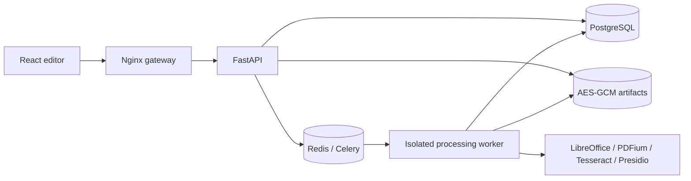

# Architecture

The web gateway is the only host-published service. Workers, Redis, PostgreSQL, and the API share an internal Docker network with no internet egress. Dependency installation and model downloads happen at image build time. The worker runs as an unprivileged account with a read-only root filesystem, limited memory/CPU/processes, and temporary files in tmpfs. Progress and persistent job states survive application restarts.

## Document lifecycle

Upload writes an AES-256-GCM encrypted original before creating a queued record. Conversion produces an encrypted PDF. Analysis creates encrypted JSON containing pages, words, bounding boxes, and detections, plus encrypted preview images. Each artifact authenticates its document ID and artifact name as associated data. Filename and rule patterns are separately encrypted in PostgreSQL. Passwords use Argon2; session tokens are stored as SHA-256 hashes.

PDFium translates native glyph bounds into the exact rendered bitmap coordinate system. OCR words use the same normalized top-left origin. OCR covers the full visible page so images embedded in native PDFs can also produce suggestions; overlapping native/OCR words are deduplicated. NLP works on reconstructed page text. Names and addresses are heuristic entities; bank account/passport candidates require nearby context. Aadhaar and card recognizers validate checksums. Other identifier patterns validate syntax and remain subject to user review.

Draft writes use optimistic version checks plus a PostgreSQL document-row lock. Finalization requires a decision for each finding, validates accepted finding geometry, and freezes selections in an Export record. Processing tasks use PostgreSQL session advisory locks, separate from progress commits, to prevent simultaneous processing of the same document. Late acknowledgements and persistent queues support recovery; failed or stalled jobs expose explicit retry. A worker process crash releases its advisory lock.

An export renders each page at 300 DPI and paints accepted areas into a new RGB image. A fresh ReportLab PDF contains only these image objects and generic metadata. Original PDF objects, attachments, OCR text, forms, annotations, and revisions are never copied. Whole-page redaction blackens the page while retaining its position. Final preview re-renders the generated artifact. Confirmation is recorded against the export ID; downloads require confirmation. Editing a draft produces another export version without changing earlier exports.

## Security boundaries

All document endpoints require the administrator session. State changes also require the session CSRF token. Sessions expire after eight hours and use HttpOnly/SameSite Strict cookies; secure cookies are enabled for HTTPS deployments. Login failures are globally throttled for a single-account installation. Nginx sets CSP, frame denial, and MIME-sniffing protections. Sensitive responses are not cached.

No endpoint logs matched sensitive strings. Audit details record actor, timestamp, categories, selection coordinates, version IDs, and artifact checksum. Deleting a document removes its original and generated artifacts while retaining audit history. Deletion is blocked while any job is active. Inputs, page count, rendering pixels, processing time, and regex complexity are bounded. Office conversion and OCR run with explicit subprocess timeouts. Custom regex also has a per-pattern execution timeout.

Database access and worker credentials remain privileged. Container isolation is a boundary, not a claim that malicious document exploits are impossible. An offline host holding the encryption key can decrypt artifacts. Native Office hidden content is excluded from rasterized PDF exports, but the retained original remains sensitive by design.

## Operational constraints

Schema initialization uses SQLAlchemy `create_all` for a fresh v1 installation. Add reviewed migrations before changing deployed schemas; this repository does not claim automatic upgrades across future incompatible schemas. Processing concurrency defaults to one to bound memory. Preview and crypto currently load individual artifacts into memory; large complex pages can exceed resources even below input limits. Failures preserve originals and return retryable status. Performance results must include hardware and document composition.

Backup pauses writers, encrypts database/artifact snapshots, and saves keys separately. Restore validates authenticated streams before writes, refuses populated target volumes, invalidates sessions, and exposes interrupted jobs for retry. A cryptographic round-trip/tamper test verifies the backup format; a complete Docker restore drill is an additional deployment acceptance check.
